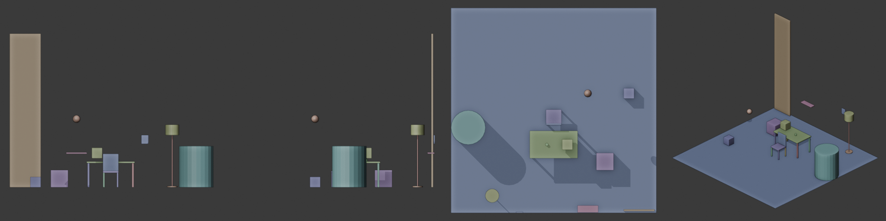

# blender-qc-audit (+ `3d-modeling` counterpart skill)

Two counterpart Blender skills for AI coding agents (Claude Code and other agents that load `SKILL.md` skills):

1. **[`skills/3d-modeling`](skills/3d-modeling/SKILL.md)** — **Build & Engineer**: guides the agent *while* creating or modifying Blender scenes (production topology, non-destructive modifier stacks, Sculpt/retopo/UV/baking workflows, high-performance `bpy`/`bmesh`/`numpy` scripting without `bpy.ops` loop stalls, physically plausible PBR albedo/roughness bounds, micro-bevels, `Non-Color` data maps, AgX look-dev, Cycles/EEVEE Next optimization, and Blender 4.0–5.2+ API compatibility).
2. **[`skills/blender-qc-audit`](skills/blender-qc-audit/SKILL.md)** — **Verify & Audit**: after the agent touches a scene, it runs a **headless, read-only audit of the saved `.blend`**. The audit checks physical plausibility, camera, lighting, materials and Blender API traps, and renders evidence views for the agent to look at before it says "done".



## Why

Research on LLM-driven Blender work keeps finding the same gap:

- Agent retry loops push bpy scripts to ~97% *executes*, while placement and shape quality stay
  flat. The leftover errors are physical: floating or disconnected parts, interpenetration,
  wrong scale, objects out of frame
  ([3DCodeBench](https://arxiv.org/abs/2606.01057), [LL3M](https://arxiv.org/abs/2508.08228)).
- Vision-model judges agree with humans only ~0.66 of the time and don't penalise physically
  wrong results ([BlenderGym](https://arxiv.org/abs/2504.01786)). GPT-4o scores 21.6% on 3D
  orientation questions ([3DSRBench](https://arxiv.org/abs/2412.07825)).
- Agents declare success from the code they wrote, or from a single render.

So the checks are numeric and run inside Blender. The renders are for judging what numbers
can't, such as composition and whether this is what the user asked for.

## What it checks

| Area | Examples |
|---|---|
| Physics (static) | floating objects and gaps to the surface below, objects sunk into or through each other (depth along the push-out axis), support graph to the ground, wall items hanging with no fixing, side-only support, tip-over (centre of mass vs footprint), real-world scale (a 1.2 m mug, a 4.5 m door, cm/m unit mix-ups), z-fighting |
| Animation | falls that ease into the floor, falls at constant speed, pops/teleports, euler flips (from F-curve keys), objects passing through others between keys, characters sinking or hovering, foot sliding |
| Simulation | steps rigid body / cloth / soft body sims in order, then checks for solver explosions, tunnelling, sims ending below the ground, collapsed soft bodies, start-of-sim overlaps, MESH collision shapes, origin far from centre of mass (Bullet uses the origin as COM), gravity vs `scale_length`, cache shorter than the shot, unbaked fluids |
| Camera | no camera, camera inside a mesh, subject out of frame / cropped / tiny / occluded, `clip_end` cutting geometry, DOF focused on nothing |
| Lighting & render | no light source, zero or extreme light energy, lights sealed inside opaque meshes, black/flat/blown renders, NaN pixels, isolated fireflies, magenta missing-texture hue |
| Materials | missing image files, data maps tagged sRGB, colour maps tagged Non-Color, textures on meshes without UVs, unlinked Material Output, empty slots, unused materials |
| Scene hygiene | helpers hidden in the viewport that still render, boolean cutters that render, stacked duplicates, leftover default cube, `rotation_euler` written on quaternion-mode objects (silently ignored), accidental armature skinning of props, unsaved/dirty files, missing libraries, blocked Python drivers |
| Geometry | inverted normals, inconsistent winding, non-manifold, loose/degenerate/duplicate geometry (strict mode for realtime/export/print) |

Physics checks default to **realistic**. When the user asks for floating islands, levitation,
zero-g, cartoon squash and stretch or abstract motion graphics, the agent sets an intent of
`stylized` or `off`, or waives specific objects. Waived findings stay in the report with their
reason; they are never silently dropped.

The skill also ships reference docs the agent reads while writing bpy: headless gotchas and
Blender 4.0 → 5.2 API changes (verified on 5.2.3), plus physics thresholds and their limits.

## Install

**Claude Code plugin:**
```
/plugin marketplace add ELTIGA/blender-qc-audit
/plugin install blender-qc-audit@blender-qc-audit
```

**Plain skill folders** (Claude Code or any agent that reads `SKILL.md`):
```bash
git clone https://github.com/ELTIGA/blender-qc-audit.git
cp -R blender-qc-audit/skills/3d-modeling ~/.claude/skills/
cp -R blender-qc-audit/skills/blender-qc-audit ~/.claude/skills/
```

Requirements: Blender 4.2+ (developed and tested on **5.2.3 LTS**, macOS/Metal) and a system
Python 3.8+ for the wrapper. No pip packages: the analysis uses Blender's bundled Python and numpy.
EEVEE/Workbench renders need a GPU context. On a Linux box without a GPU, the analysis still
runs; use Cycles for the camera view or skip renders with `--no-render`.

## Use

The agent triggers the skill on its own after creating or changing a scene. To run it by hand:

```bash
python3 skills/blender-qc-audit/scripts/run_qc.py scene.blend --out-dir qc_out \
    [--intent intent.json] [--frames 1,mid,end] [--focus "Mug*"] [--no-render]
```

Exit code is 0 for no FAIL findings, 2 if there are FAILs, and 1 if the tool itself broke.
Outputs: `qc.md` (human summary), `qc.json` (findings, plus an inventory with world bounding
boxes in metres, material colours and camera-space positions), `camera_f*.png`,
`contact_sheet.png` and `render_report.json`. Blender is found via `--blender`, `$BLENDER`,
`PATH`, or the usual install locations.

Sample `qc.md` from the bundled defect scene:

```
## FAIL
- physics.floating - 'Crate' touches nothing and floats 10.0 cm above 'Table_Top'.
- physics.intersection - 'Table_Top' and 'Mug' interpenetrate by ~3.0 cm.
- physics.scale - 'Coffee_Cup' max is 1.20 m; a real cup is 5.0 cm-20.0 cm.
- image.missing - Image 'plaster_albedo' points to a missing file (renders magenta/pink).
## WARN
- anim.fall_eases_out - 'Ball' slows down before landing at frame 36 (drop 1.89 m) ...
- transform.rotation_mode_ignored - 'Shelf_Rotated' has rotation_euler set but rotation_mode is QUATERNION ...
- objects.hidden_but_renders - 'Helper_Proxy' is hidden in the viewport but WILL render ...
```

Inside a live session (for example a blender-mcp `execute_blender_code` tool), the analysis can
run in-process. It restores the frame and selection and never saves:
```python
import runpy
runpy.run_path(".../scripts/blender_qc.py", run_name="__main__",
               init_globals={"QC_ARGV": ["--out", "/tmp/qc/qc.json"]})
```

See [`skills/blender-qc-audit/SKILL.md`](skills/blender-qc-audit/SKILL.md) for the agent
workflow, the intent file format and the triage guide.

## Tests

```bash
python3 tests/run_tests.py            # builds 4 fixture scenes with planted defects and checks the findings
```

`skills/blender-qc-audit/evals/` holds three agent-level eval cases in the `claude plugin eval`
layout: fix a defect room, floating islands that must stay floating, and a desk scene built
from scratch.

## Status and known limitations (v0.1.0)

- Calibrated on synthetic fixtures and one ~500-object production interior. On the production
  set it found real bugs its existing QC had missed: a cabinet door animated through a wall,
  books sunk 2-3 cm into shelves, props intersecting.
- First eval round with Claude Opus 5.5: both with and without the skill, all assertions passed
  when the prompt explicitly asked to fix or verify. The skill's edge showed in issues the
  prompt didn't ask about (for example a lamp bulb left floating with its light sealed inside).
  It costs about 18% more tokens. Harder evals, where QC isn't requested, are next.
- Several rules use name heuristics: scale ranges, soft/compressible materials, wall-mounted
  items, airborne things, architecture. Meaningful object names give better results.
- Known false positive: rocks or posts deliberately half-buried in terrain are reported as
  intersections.
- Known gap: small subjects the audit detects automatically skip the occlusion test. List them
  as `subjects` in the intent file to check them.
- Open or non-manifold meshes fall back to a two-sided depth estimate and enclosure isn't
  detected for them.

Issues and PRs welcome, especially failure cases from real agent sessions and Blender versions
other than 5.2.

## License

MIT
